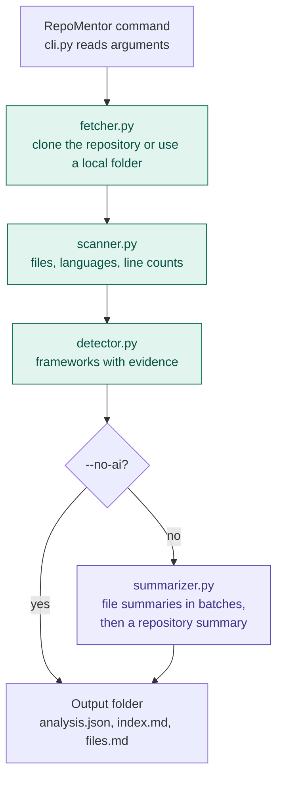
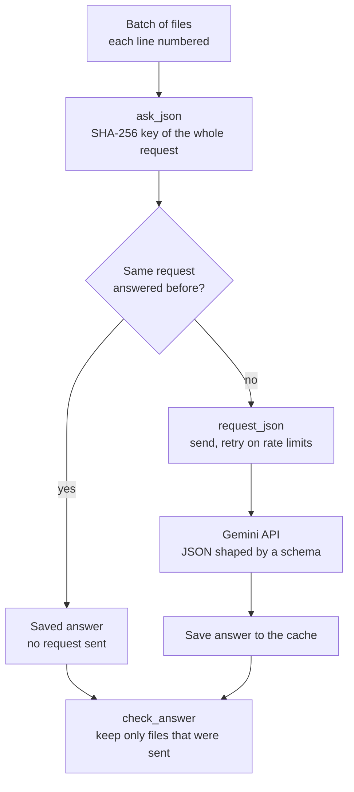
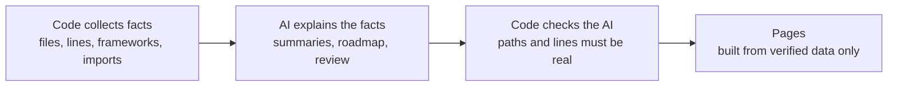
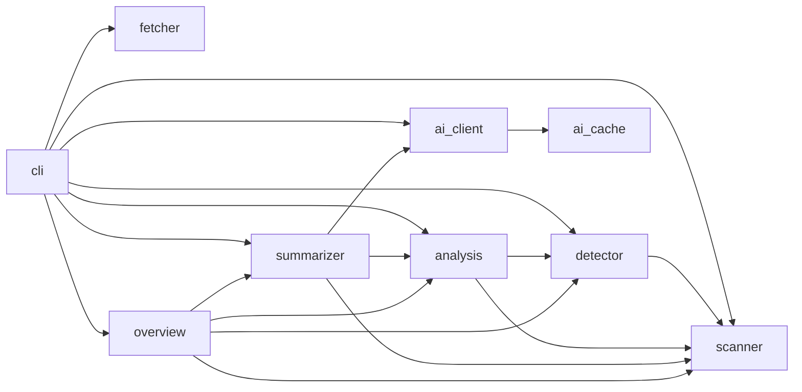
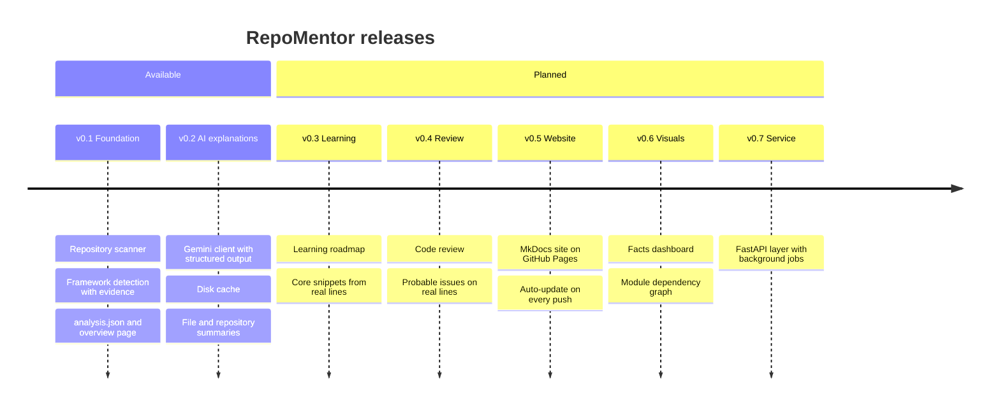

# RepoMentor

RepoMentor analyzes any GitHub repository and explains it the way a senior engineer would on a new developer's first day: what the project does, how it is organized, which frameworks it uses, and what each file is for.

It collects facts with plain code first, then asks an AI model to explain them, and checks every answer against the real files before writing anything.

**Status:** early development, version 0.1.0. The command-line tool works end to end today; the website, learning roadmap and code review are in progress. See [Release plan](#release-plan).

---

## Contents

- [What it produces](#what-it-produces)
- [How it works](#how-it-works)
- [Installation](#installation)
- [Usage](#usage)
- [Output files](#output-files)
- [Design principles](#design-principles)
- [Project structure](#project-structure)
- [Release plan](#release-plan)
- [Known limitations](#known-limitations)

---

## What it produces

| Feature | What you get | Uses AI | Status |
|---|---|---|---|
| Repository scan | Every useful file with its language and line count; junk folders, lock files and binaries skipped | No | Available |
| Framework detection | Frameworks and tools found in dependency files, imports and config files, each with the file and line that proves it | No | Available |
| Problems found without AI | Libraries imported but never declared, files that could not be parsed | No | Available |
| File summaries | What each code file does, grouped by role (core, tests, utilities, and so on) | Yes | Available |
| Repository summary | What the project is, how it works, and which files to read first | Yes | Available |
| Learning roadmap | What to learn, in order, to understand the repository | Yes | Planned |
| Core snippets | Key code cut from the real files with line numbers, never generated | Yes | Planned |
| Code review and probable issues | Suggestions and likely bugs, each pointing to a real line | Yes | Planned |
| Website | All pages published with MkDocs on GitHub Pages, updated on every push | No | Planned |

---

## How it works



Green steps collect facts with ordinary code and always run. The purple step is the only one that calls the AI. If the AI fails, for example because the daily quota is used up, the facts are still written.

### One AI request, step by step

Every AI call goes through a single function, `ask_json`, which checks a disk cache before contacting Gemini:



Because the cache key includes the file contents, the prompt and the model name, an unchanged repository costs no requests on the second run, and a change to one file only re-sends the batch that contains it.

---

## Installation

### Requirements

- Python 3.10 or newer
- Git
- A Gemini API key from [Google AI Studio](https://aistudio.google.com/apikey) (the free tier is enough to start)

### Steps

Windows (Command Prompt):

```cmd
git clone https://github.com/HanaNabhan/RepoMentor.git
cd RepoMentor
python -m venv .venv
.venv\Scripts\activate.bat
python -m pip install --upgrade pip
python -m pip install -e .
```

macOS and Linux:

```bash
git clone https://github.com/HanaNabhan/RepoMentor.git
cd RepoMentor
python3 -m venv .venv
source .venv/bin/activate
python -m pip install --upgrade pip
python -m pip install -e .
```

### Set the API key

The key is read from an environment variable and never stored in the project.

Windows (then restart your terminal or editor):

```cmd
setx GEMINI_API_KEY "your-key"
```

macOS and Linux (add the line to your shell profile to keep it):

```bash
export GEMINI_API_KEY="your-key"
```

Check the installation:

```cmd
RepoMentor --version
```

---

## Usage

```cmd
RepoMentor https://github.com/pallets/flask
```

Example output:

```
Cloning https://github.com/pallets/flask
Repository ready: C:\Users\you\.repomentor\repos\pallets\flask
Scanned 230 files, skipped 6
Language              Files    Lines
Python                   83    18392
reStructuredText         79    14648
...

Category          Framework       Found in
CLI               Click           pyproject.toml
Library           Jinja           pyproject.toml
Library           Werkzeug        pyproject.toml
Testing           pytest          pyproject.toml
Tooling           GitHub Actions  .github/workflows/lock.yaml

Summarizing files: batch 1 of 9
...
Summarizing the repository
AI: 10 requests, 0 from cache

Wrote repomentor-output\analysis.json
Wrote repomentor-output\index.md
Wrote repomentor-output\files.md
```

### Options

| Option | Description | Default |
|---|---|---|
| `repo` | A GitHub URL such as `https://github.com/owner/name`, or a path to a local folder | required |
| `--output FOLDER` | Where to write the results | `repomentor-output` |
| `--no-ai` | Skip all AI steps and write only the facts | off |
| `--version` | Print the version and exit | |

### Environment variables

| Variable | Purpose | Default |
|---|---|---|
| `GEMINI_API_KEY` | Your Gemini API key | required for AI steps |
| `REPOMENTOR_MODEL` | The Gemini model to use | `gemini-3.5-flash-lite` |

### Exit codes

| Code | Meaning |
|---|---|
| `0` | Everything finished |
| `1` | An error, or the AI step stopped before finishing (the facts are still written; run the same command again to continue from the cache) |

### Examples

```cmd
:: Analyze a local project without using AI
RepoMentor C:\path\to\project --no-ai

:: Write the results somewhere else
RepoMentor https://github.com/pallets/flask --output flask-docs

:: Use a different Gemini model for this terminal session
set REPOMENTOR_MODEL=gemini-3.5-flash
RepoMentor https://github.com/pallets/flask
```

---

## Output files

```
repomentor-output/
  analysis.json   all collected facts and AI results, in one file
  index.md        overview page: summary, languages, frameworks, things to check, structure
  files.md        every file grouped by role, with what it does
```

`analysis.json` is the single source of truth: every page is built from it, and the AI steps read from it. It contains no timestamp, so the same repository always produces the same file.

| Field | Content |
|---|---|
| `name`, `source` | Repository name and where it came from |
| `total_files`, `total_lines`, `skipped_files` | Size of the repository |
| `languages` | Files and lines per language |
| `frameworks` | Each framework with its category, how it was found, and the file and line |
| `unparsed_files` | Files that could not be read for imports |
| `files` | Every scanned file with its language and line count |
| `file_summaries` | AI summary and role for each code file |
| `repo_summary` | AI purpose, how it works, and key files |

Cloned repositories and AI answers are cached in your user folder, under `.repomentor`, outside the project.

---

## Design principles



1. **Facts before AI.** Everything that can be measured is measured with ordinary code, and the AI is given those facts instead of guessing them.
2. **Never trust, always check.** Every file path or line number the AI returns is checked against the scan. Anything invented is dropped.
3. **Real code only.** Snippets are cut from the actual files by RepoMentor; the AI only chooses which lines.
4. **Pay once.** Answers are cached by the exact request, so repeated runs and automated runs only pay for what changed.
5. **Fail safely.** An AI failure never loses the facts, and a rerun continues where it stopped.

---

## Project structure

```
RepoMentor/
  pyproject.toml          package settings, dependencies and the RepoMentor command
  src/repomentor/
    cli.py                command-line entry point; runs the steps in order
    fetcher.py            clones a GitHub URL or uses a local folder
    scanner.py            lists files, languages and line counts; skips junk
    detector.py           detects frameworks from dependency files, imports and config files
    analysis.py           the data records and analysis.json
    overview.py           builds index.md and files.md
    summarizer.py         AI file and repository summaries
    ai_client.py          the only place that talks to Gemini
    ai_cache.py           saves AI answers on disk
```

How the modules depend on each other (an arrow means "imports"):



Every arrow points one way, with no cycles. Switching to another AI provider would mean changing `ai_client.py` only.

### Dependencies

| Package | Why |
|---|---|
| `tomli` | Reads `pyproject.toml` files on Python 3.10 |
| `google-genai` | Google's official SDK for the Gemini API |
| `httpx` | Used directly to report network errors clearly |

Everything else comes from the Python standard library.

---

## Release plan



| Version | Content | Status |
|---|---|---|
| v0.1 | Scanner, framework detection, `analysis.json`, overview page | Done |
| v0.2 | Gemini client, cache, file and repository summaries | Done |
| v0.3 | Learning roadmap, core snippets | Next |
| v0.4 | Code review and probable issues | Planned |
| v0.5 | MkDocs website, GitHub Action that regenerates and publishes it on every push | Planned |
| v0.6 | Facts dashboard and module dependency graph (no AI) | Planned |
| v0.7 | FastAPI service (optional) | Planned |

---

## Known limitations

- Python imports are read with Python's own parser, so a file using syntax newer than the running Python is reported as unparsed rather than analyzed.
- Framework detection from imports covers Python and notebooks; JavaScript and TypeScript projects are detected from `package.json` only.
- On the Gemini free tier, the daily request limit can stop a large repository partway. The finished work is cached, and running the same command later continues from there.
- On the Gemini free tier, Google's terms allow it to use submitted content to improve its products. Only analyze code you are allowed to share.

---

## Author

Built by [Hana Nabhan](https://github.com/HanaNabhan) as a portfolio project.